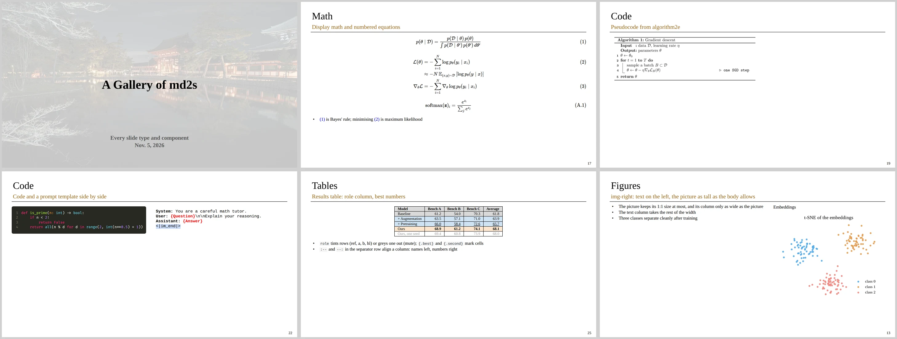

# md2s

**Stop making slides, do research.** md2s turns one plain Markdown file into academic slides that read
well and all look alike: a vector PDF, a PPTX of pictures, or an HTML deck to present from, with a laser
pointer and a pen. The Markdown is the kind any LLM already writes, so an agent can draft the deck too.



It is [Marp](https://marp.app) underneath, plus what research talks need and Marp leaves out:

- one house style, set by the theme: title page, section pages, a title / subtitle / rule header, slide numbers
- per-slide footnotes, numbered equations with `\label` / `\eqref`, a contents slide (`toc: true`)
- BibTeX citations (`bibliography: refs.bib`, `[@key]`) with a References page, in APA, IEEE or any CSL style
- layouts without CSS: `<!-- _layout: img-right -->`, `::: a` areas, `middle`
- callouts (`> [!NOTE]`), tables with row tints, code with line numbers that copying leaves out
- ```` ```dot ```` (Graphviz) and ```` ```algo ```` (algorithm2e) fences, PDF pages, GIFs, videos and YouTube links
- a `###` that runs over continues after `---`, numbered (1/2), (2/2)

## Install

Linux (Ubuntu, Debian, WSL) or macOS, with Node 18 or newer:

```bash
npm install -g @torridfish/md2s    # puts md2s on the PATH
md2s setup                         # installs what is missing, asking first
```

`npx @torridfish/md2s deck.md --pdf` runs it without installing (run `npx @torridfish/md2s setup` once
first).

`md2s setup` needs no sudo. If there is no Chrome, Chromium, Edge or Firefox, it downloads Chrome for
Testing (about 400 MB unpacked) into `~/.cache/md2s`. Without TeX it downloads TinyTeX (about 250 MB) for
```` ```algo ```` fences, and on request it adds Noto Serif CJK TC (50 MB) for Chinese text. Poppler and
ffmpeg need the system package manager, so it prints that command (`sudo apt-get install poppler-utils`)
for you to run. Tools already on the system are used as they are. `md2s --check` lists what is there, and
`md2s setup --yes` installs without asking.

`npm install` reports audit warnings from Marp's own dependency tree (`basic-ftp`, `extract-zip`,
`chromium-bidi`, …) and one low from KaTeX. None of them is code md2s calls directly; they arrive with the
renderer. `npm audit fix --force` will break Marp, so it is not applied here.

From source, to work on md2s itself: `git clone https://github.com/torridfish/md2s.git && cd md2s`, then
`npm ci && npm link` (the `md2s` on the PATH then runs this checkout), `md2s setup`, and `npm test`.

## Use

```bash
md2s deck.md                   # deck.pdf
md2s deck.md --pdf --pptx --html
md2s deck.md --serve           # present at http://localhost:8080/deck.md
md2s --skill                   # every bit of syntax, written for an agent (or you)
```

`examples/gallery.md` shows every slide type and component; render it after changing the theme.
Your own defaults (any front matter setting) go in `~/.config/md2s/config.yaml`, your math macros in
`~/.config/md2s/macros.tex`. Figures are files you export yourself: SVG, PNG, PDF, GIF, video.

The cover photo in `themes/` is the author's own. `csl/ieee.csl` is from the
[CSL project](https://github.com/citation-style-language/styles), CC BY-SA 3.0. The fonts in
`themes/fonts/` are subsets of Liberation Serif and Mono, Fira Code (SIL OFL 1.1) and FreeSerif (GPL with
the font exception): see [themes/fonts/README.md](themes/fonts/README.md).
