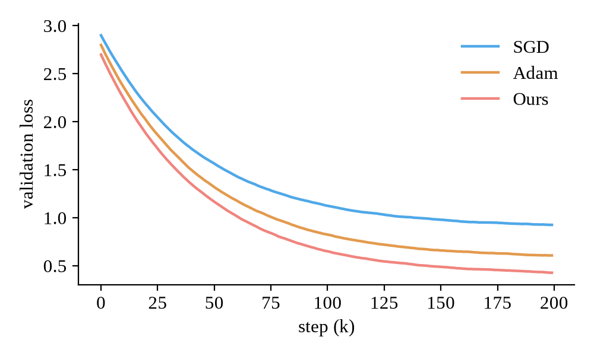
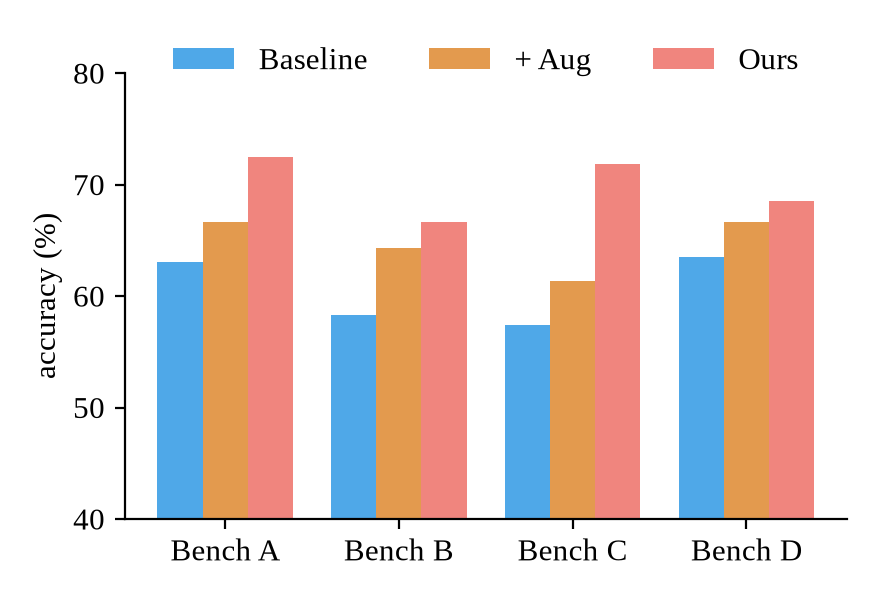
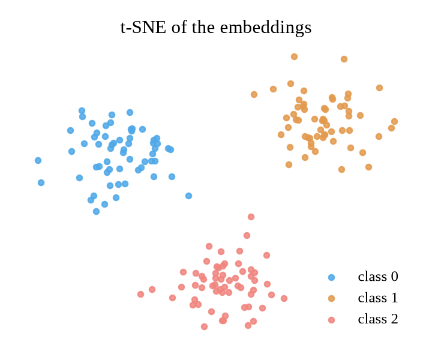
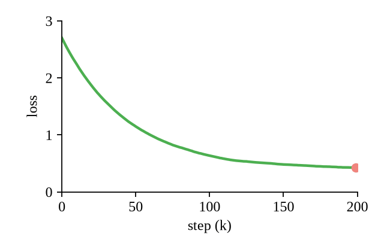
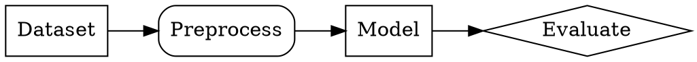
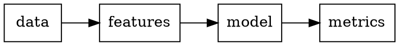

<!-- md2s gallery: every slide type and component, with made-up content. Render it after every theme or
     engine change (md2s examples/gallery.md --pdf -o out/) and read every page. The figures are made by
     assets/make.py. -->

# A Gallery of md2s

Every slide type and component
Nov. 5, 2026

# How does one slide read?

[^sec]: A section page can carry a footnote too, such as a project link: <https://github.com/marp-team/marp>

## Writing
### Lead, lists, inline marks and inline math

> A lead states the claim or the question in a sentence or two, with the **one term** the slide turns on.[^lead]

Plain text with `a/config/key`, a [link](https://marp.app), ==work in progress==, [run 4-03]{.callout}, [a blocker]{.alert}, [the formula]{.formula} and [a tentative aside]{.faint}.

- A bullet with inline math: softmax is $\sigma(\mathbf z)_i = e^{z_i} / \sum_j e^{z_j}$
  - a nested bullet, two characters further in
- A long bullet wraps under its own text, not under the bullet, however many words it takes to say the thing that needs saying

1. A numbered finding
   1. its sub-point
2. A second finding

➔ A consequence line hangs after its arrow when it wraps, which it does here because it is long enough to wrap

[^lead]: Footnotes are numbered per slide, in the order they are cited.
[^uncited]: A footnote nobody cites stays on the slide it is written in.

### Citations

> Cite with `[@key]` from the deck's `bibliography:`; each marker links to the References slides at the end.

- Self-attention replaced recurrence [@vaswani2017attention], and residual connections made depth trainable [@he2016deep]
- Two works at once [@devlin2019bert; @dosovitskiy2021image]
- Training minimises the loss \eqref{eq:nll}, which a later slide defines: references to equations work forwards too
- Footnotes stay separate from citations[^fn-vs-cite]

[^fn-vs-cite]: A footnote is a per-slide note; a citation points into the bibliography, here with Adam [@kingma2015adam].

### Callouts

> [!NOTE]
> A note with **bold**, a list and math: $p(y \mid x)$.

> [!TIP] Name the run, not the idea
> - "4-03 beats 4-00", not "the new loss works"

> [!WARNING] The test set was seen during tuning

> [!CAUTION]
> Numbers on this slide are from a single seed.

### A subsection that runs over

- The first part of a list too long for one slide
- A `---` with no heading after it continues on the next slide

---

- The second part: same title and subtitle, numbered (2/2)
- The contents slide lists the subsection once

# Figures and media

## Figures
### One figure, at 1:1, centred



### An SVG: vector, placed at its own size

")

### Two figures in a row

 

### img-right: text on the left, the picture as tall as the body allows

<!-- _layout: img-right -->

::: a
- The picture keeps its 1:1 size at most, and its column only as wide as the picture
- The text column takes the rest of the width
- Three classes separate cleanly after training
:::

::: b

:::

### A YouTube video: a player in --html, its thumbnail in the PDF


### A GIF and a PDF page

<!-- _layout: two -->

::: a

:::

::: b

:::

# Math, code and diagrams

## Math
### Display math and numbered equations

$$
\begin{equation}
\label{eq:bayes}
p(\theta \mid \mathcal D) = \frac{p(\mathcal D \mid \theta)\, p(\theta)}{\int p(\mathcal D \mid \theta')\, p(\theta')\, d\theta'}
\end{equation}
$$

```math
\begin{align}
\mathcal L(\theta) &= -\sum_{i=1}^{N} \log p_\theta(y_i \mid x_i) \label{eq:nll} \\
  &\approx -N\, \mathbb E_{(x, y) \sim \mathcal D}\left[\log p_\theta(y \mid x)\right] \notag \\
\nabla_\theta \mathcal L &= -\sum_{i=1}^{N} \nabla_\theta \log p_\theta(y_i \mid x_i)
\end{align}
```

$$
\operatorname{softmax}(\mathbf z)_i = \frac{e^{z_i}}{\sum_j e^{z_j}} \tag{A.1}
$$

- \eqref{eq:bayes} is Bayes' rule; minimising \eqref{eq:nll} is maximum likelihood

### Equation slide (class equation)

<!-- _class: equation -->

$$
\boxed{\;\mathrm{Attention}(Q, K, V) = \operatorname{softmax}\!\left(\frac{QK^\top}{\sqrt{d_k}}\right) V\;}
$$

## Code
### Pseudocode from algorithm2e

```algo
\begin{algorithm}[H]
\caption{Gradient descent}
\Input{data $\mathcal D$, learning rate $\eta$}
\Output{parameters $\theta$}
$\theta \gets \theta_0$\;
\For{$t = 1$ \KwTo $T$}{
  sample a batch $B \subset \mathcal D$\;
  $\theta \gets \theta - \eta \nabla_\theta \mathcal L_B(\theta)$ \Comment*[r]{one SGD step}
}
\Return{$\theta$}
\end{algorithm}
```

### Code with a path label and a first line number

```python {path="train.py" start=42}
def train_step(model, batch, optimizer):
    """One optimisation step; returns the loss as a float."""
    optimizer.zero_grad()
    loss = model(batch.inputs).cross_entropy(batch.labels)
    loss.backward()
    optimizer.step()
    return loss.item()
```

### Code without line numbers

```python {.no-lines}
for epoch in range(epochs):
    train_step(model, next(batches), optimizer)
```

`line-numbers: false` in the front matter turns them off for a whole deck; `{.lines}` turns one block back on.

### Code and a prompt template side by side

<!-- _layout: two -->

```python
def is_prime(n: int) -> bool:
    if n < 2:
        return False
    return all(n % d for d in range(2, int(n**0.5) + 1))
```

```prompt
System: You are a careful math tutor.
User: {Question}\n\nExplain your reasoning.
Assistant: {Answer}
<|im_end|>
```

## Diagrams
### Graphviz dot





# Tables and layouts

## Tables
### Results table: role column, best numbers

| role | Model | Bench A | Bench B | Bench C | Average |
| --- | :-- | --: | --: | --: | --: |
| ref | Baseline | 61.2 | 54.0 | 70.3 | 61.8 |
| a | + Augmentation | 63.5 | 57.1 | 71.0 | 63.9 |
| a | + Pretraining | 66.0 {.second} | 58.4 {.second} | 72.6 {.second} | 65.7 {.second} |
| b | Ours | 68.9 {.best} | 61.2 {.best} | 74.1 {.best} | 68.1 {.best} |
| mute | Ours, one seed | 69.4 | 60.8 | 73.9 | 68.0 |

- `role` tints rows (ref, a, b, hl) or greys one out (mute); `{.best}` and `{.second}` mark cells
- `:--` and `--:` in the separator row align a column: names left, numbers right

### Table styles: booktabs, merged cells and a caption

| Model | Bench A    || Bench B    ||
| ^^    | acc | F1   | acc  | F1   |
| :--   | :-: | :-:  | :-:  | :-:  |
| Baseline | 61.2 | 58.0 | 54.0 | 50.3 |
| Ours  | 68.9 {.best} | 64.1 {.best} | 61.2 {.best} | 57.7 {.best} |
| ^^    | 67.5 | 63.0 | 60.4 | 56.9 |
[Two seeds of Ours; `||` spans the next column, `^^` the row above, in the header too]

{.booktabs}

- A class on the line under a table picks its style: `grid` (the default), `booktabs`, `plain`, `striped`

### Literature table

| Method | Paper | Data | Open source |
| --- | --- | --- | --- |
| Transformer | [@vaswani2017attention] | WMT | v |
| BERT | [@devlin2019bert] | BooksCorpus, Wikipedia | v |
| ViT | [@dosovitskiy2021image] | ImageNet-21k | v |

{.settings}

## Layout
### fit-left: a table and its notes

<!-- _layout: fit-left -->

| Setting | Value |
| --- | --- |
| optimizer | AdamW |
| learning rate | 3e-4 |
| batch size | 256 |
| warm-up | 2k steps |

::: b
- The table's column is only as wide as the table
- The notes take the rest of the width
:::

### Custom areas, centred vertically

<!-- _layout: "a b" "a c" / auto 1fr middle -->

<style scoped>.area-c { background: var(--band-blue); }</style>

::: a

:::

::: b
- Area **b**, top right: `"a b" "a c" / auto 1fr`
:::

::: c center
**Area c, centred in its cell**, tinted by `<style scoped>.area-c { … }`
:::

### Rows without sizes: as tall as their content, the last one takes the rest

<!-- _layout: "eq eq" "p z" "l l" / 1fr 1fr -->

::: eq
$$
\mathcal L(\theta) = -\sum_{i=1}^{N} \log p_\theta(y_i \mid x_i)
$$
:::

::: p
$$
p_\theta(y \mid x) = \operatorname{softmax}(f_\theta(x))_y
$$
:::

::: z
$$
\nabla_\theta \mathcal L = -\sum_{i} \nabla_\theta \log p_\theta(y_i \mid x_i)
$$
:::

::: l
- No row sizes in `"eq eq" "p z" "l l"`: the formulas keep their height and this list sits right under them
- Write a size after a row's quotes (`"p z" 1fr`) to change that
:::

### Prose page with a body rule

<!-- _class: prose -->

**Question:** why does the validation loss rise after step 120 while the training loss keeps falling?

[Probably overfitting; check with a held-out split.]{.faint}

<hr class="rule">

Next: early stopping at the best validation step, and a second seed.

## TODO
### Week of Nov. 10

- **Rerun the ablation with three seeds**
- ➔ Write up the results table for the reading group
